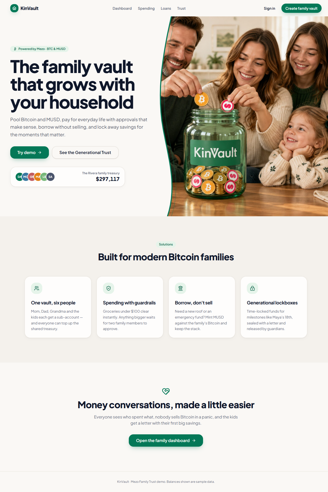
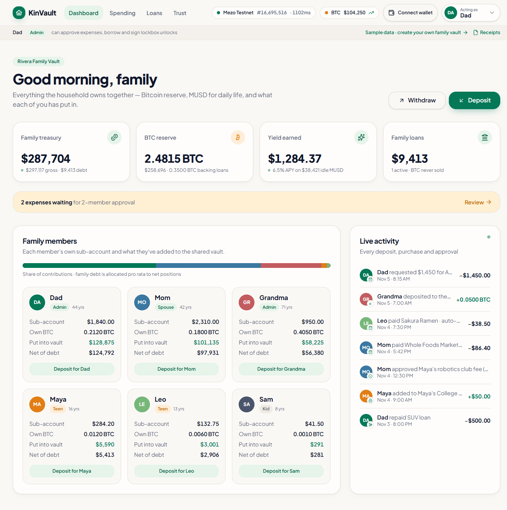
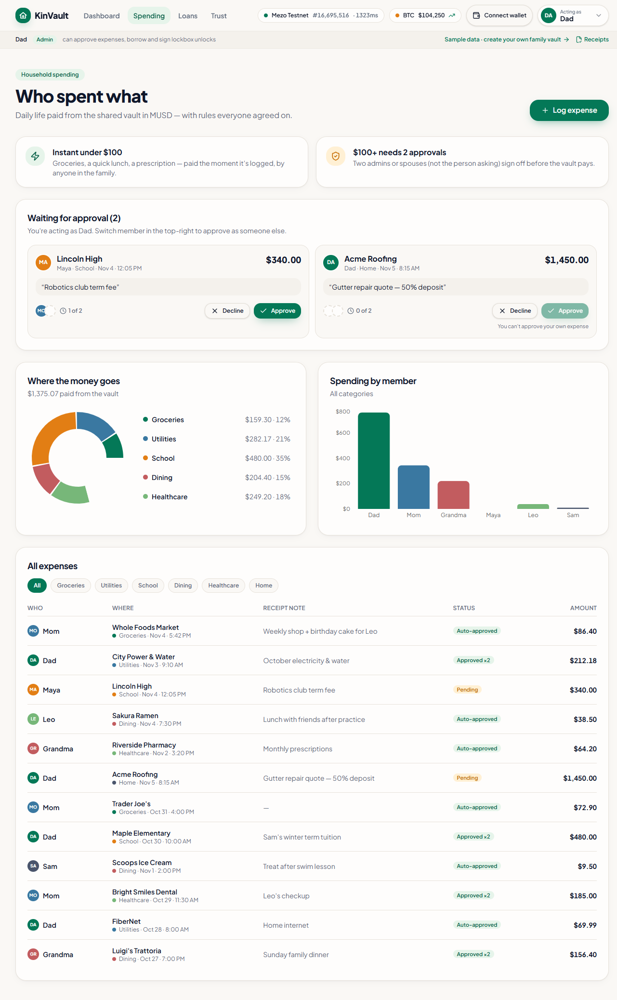
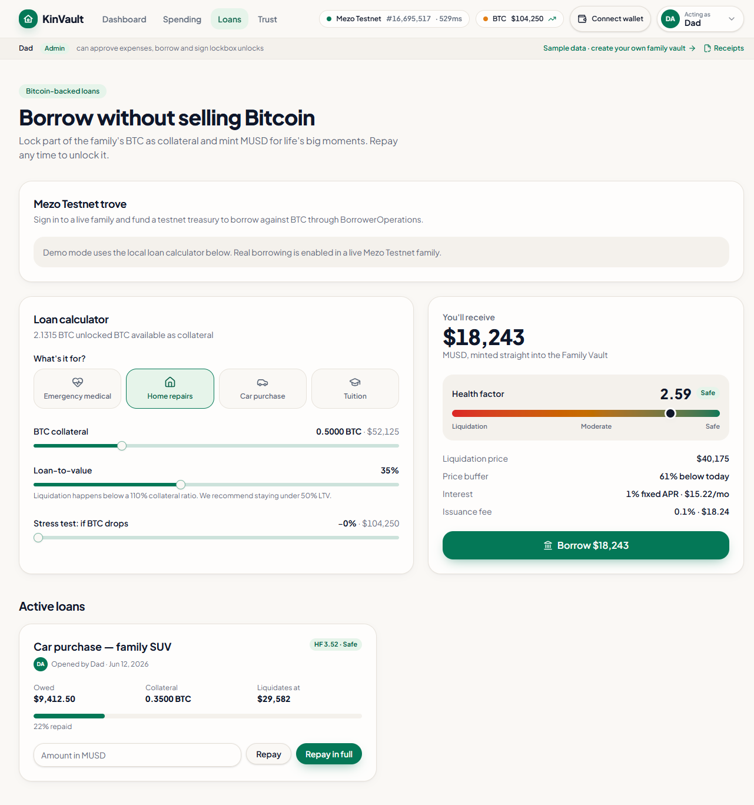
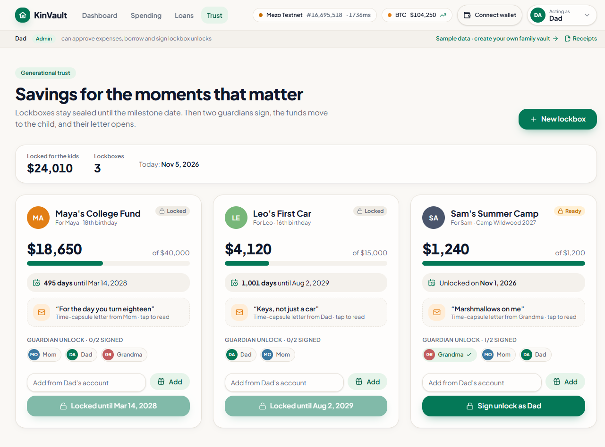

# KinVault — a family vault on Mezo Testnet

KinVault is a household finance app for families who hold **BTC** and **MUSD** on
[Mezo](https://mezo.org). Up to six family members share a vault, pay for everyday
life in MUSD under two-approval rules, and borrow MUSD against BTC through Mezo's
own `BorrowerOperations` rather than selling the Bitcoin.

> **North star:** families pay for household life and their children's futures
> without selling their Bitcoin.

**This repository targets Mezo Testnet only (chain 31611).** There is no mainnet
configuration in the chain layer.

---

## Screenshots

**Landing**



**Family dashboard**



**Spending with two-approval rules**



**Borrowing against BTC**



**Generational lockboxes**



These are demo-mode captures. The network pill in the header shows the live
Mezo Testnet block height and BTC price from `PriceFeed.fetchPrice()`.

---

## What is actually on-chain

| Flow                   | What happens                                                                                                                                                                                                    |
| ---------------------- | --------------------------------------------------------------------------------------------------------------------------------------------------------------------------------------------------------------- |
| **Fund with MUSD**     | The member's wallet sends canonical testnet MUSD to the family treasury. The server verifies the ERC-20 `Transfer`, then credits the ledger.                                                                    |
| **Fund with test BTC** | Native test BTC moves from the member's wallet to the treasury; the server verifies the transaction value, sender and recipient.                                                                                |
| **Pay an expense**     | After the family's approval rules pass, the treasury wallet sends MUSD to the merchant. The server verifies the transfer before debiting the treasury.                                                          |
| **Withdraw**           | The treasury wallet sends test MUSD or BTC to a member's linked wallet. The server verifies the sender, recipient, asset and amount before debiting.                                                            |
| **Borrow**             | The treasury wallet calls `BorrowerOperations.openTrove` with native test BTC. The server decodes the call and requires the matching `TroveUpdated` event before recording collateral and debt.                 |
| **Repay**              | A partial repayment calls `repayMUSD`; a full repayment calls `closeTrove()` (which also returns the 200 MUSD gas compensation). The server decodes the call and derives the repaid amount from MUSD burn logs. |
| **Price**              | Loans and the UI read `PriceFeed.fetchPrice()` from Mezo, not CoinGecko or an owner-posted number.                                                                                                              |
| **Trove state**        | `TroveManager.getTroveStatus/getTroveColl/getTroveDebt/getCurrentICR` are read live.                                                                                                                            |

The browser only ever sends a **transaction hash** to the server. The server
independently fetches the receipt and checks the chain, contract, sender,
recipient, amount and confirmations before touching the family ledger.

### Verified testnet contracts

| Contract           | Address                                      |
| ------------------ | -------------------------------------------- |
| MUSD (18 decimals) | `0x118917a40FAF1CD7a13dB0Ef56C86De7973Ac503` |
| MEZO (18 decimals) | `0x7B7c000000000000000000000000000000000001` |
| BorrowerOperations | `0xCdF7028ceAB81fA0C6971208e83fa7872994beE5` |
| TroveManager       | `0xE47c80e8c23f6B4A1aE41c34837a0599D5D16bb0` |
| PriceFeed          | `0x86bCF0841622a5dAC14A313a15f96A95421b9366` |
| HintHelpers        | `0x4e4cBA3779d56386ED43631b4dCD6d8EacEcBCF6` |
| SortedTroves       | `0x722E4D24FD6Ff8b0AC679450F3D91294607268fA` |

Network:

| Parameter    | Value                            |
| ------------ | -------------------------------- |
| Chain ID     | `31611` (`0x7b7b`)               |
| RPC          | `https://rpc.test.mezo.org`      |
| WSS          | `wss://rpc-ws.test.mezo.org`     |
| Explorer     | `https://explorer.test.mezo.org` |
| Faucet       | `https://faucet.test.mezo.org/`  |
| Testnet dApp | `https://testnet.mezo.org`       |

> The Buildathon asset is **MUSD**. The testnet mUSDC address in older docs is
> not deployed at that address on chain 31611; KinVault uses canonical MUSD.

---

## Architecture

```text
Browser (React 19 / TanStack Start)
  routes + vault components
  src/lib/chain/client.ts        read-only viem public client (PriceFeed, troves, balances)
  src/lib/chain/transactions.ts  EIP-1193 wallet writes (MUSD/BTC, openTrove, repayMUSD/closeTrove)
  src/lib/vault-store.ts         demo store + authoritative live hydration (no optimistic balances)
        │
        │  tx hash only
        ▼
Server (TanStack Start server functions)
  requireSupabaseAuth
  src/lib/chain/verify.server.ts verify receipt, token, from/to, amount, chain, confirmations
  src/lib/chain/ledger.ts        pure ledger bridge (deposit, payment, trove)
  family.server.ts               membership + optimistic-concurrency ledger writes
        │
        ▼
Supabase Postgres (RLS)  ·  families · family_members · family_invites ·
                           vault_ledgers · onchain_transactions
```

Key decisions:

- **One chain config.** All addresses and endpoints live in
  `src/lib/chain/config.ts`; mainnet is deliberately absent.
- **Server-authoritative writes.** The browser cannot credit a deposit or settle
  an expense without a verified Mezo receipt. Live mode never shows an
  optimistic balance: it waits for the server's ledger.
- **Event-anchored troves.** `openTrove`, `repayMUSD` and `closeTrove` are
  decoded from the transaction input, and the matching `TroveUpdated` operation
  is required. Current trove state alone is not accepted as proof.
- **Replay protection.** `onchain_transactions.tx_hash` is a primary key, so a
  transaction can only be consumed once.
- **Protocol-native borrowing.** Troves are opened and repaid through
  `BorrowerOperations`; `PriceFeed`, `TroveManager` and the live
  `minNetDebt()`/gas-compensation values are the source of truth.
- **Hash-chained ledger.** Activity entries keep the existing SHA-256 chain and
  commit to a `txHash` when one is present. Older entries remain valid.
- **Accounting is net of debt.** The dashboard counts outstanding loans against
  pool assets and allocates the debt pro rata to member net positions.

---

## Family rules

All rules are pure functions in `src/lib/vault-logic.ts`:

| Rule                      | Value                                                         |
| ------------------------- | ------------------------------------------------------------- |
| Instant expense           | strictly under **$100 MUSD**                                  |
| Larger expense            | **2 distinct approvals** from admin/spouse, not the requester |
| Roles                     | admin/spouse approve; teen/kid cannot                         |
| Default allowances        | teen $50/day; kid $15/day and School/Groceries only           |
| Family size               | max 6                                                         |
| Trove MCR                 | 110% (protocol)                                               |
| Minimum trove net debt    | 1,800 MUSD (read live from `BorrowerOperations.minNetDebt()`) |
| Protocol gas compensation | 200 MUSD (added to trove debt)                                |
| Lockbox release           | matured + 2 distinct guardian signatures                      |
| Unfreeze                  | 2 distinct guardian signatures                                |

---

## Project layout

```text
src/
  lib/
    chain/
      config.ts          Mezo Testnet, token/protocol addresses, explorer helpers
      abis.ts            ERC-20, PriceFeed, BorrowerOperations, TroveManager, hints
      amounts.ts         BigInt token/price helpers
      client.ts          read-only RPC: chain status, balances, PriceFeed, trove
      protocol.ts        trove planning and summaries
      transactions.ts    wallet writes (MUSD/BTC, openTrove, repayMUSD/closeTrove)
      verify.server.ts   server-only receipt + call + event verification
      ledger.ts          pure on-chain -> ledger bridge (deposit, payment, withdrawal, trove)
    mezo.ts              testnet heartbeat + PriceFeed store
    wallet.ts            EIP-1193 wallet state and balances
    family.functions.ts  authenticated server functions
    family.server.ts     membership, seat sync, optimistic concurrency
    vault-engine.ts      shared action engine and ledger types
    vault-store.ts       demo/live client store
  routes/                landing, auth, dashboard, spending, loans, trust, family
  components/vault/      app shell, wallet, fund/pay dialogs, trove panel, ledger
blockchain.test.ts       root blockchain test suite
TESTING.md               every automated and manual check
drizzle/migrations/      families, seats, invites, ledgers, onchain_transactions
```

---

## Setup

Requirements: Bun (or Node.js 20+) and a browser wallet.

```sh
bun install
cp .env.example .env   # then fill in the Supabase values
bun run dev
```

`.env` is git-ignored. The server needs `SUPABASE_SERVICE_ROLE_KEY` for verified
ledger writes; the browser only receives the publishable key.

Environment variables:

| Variable                                             | Used by                                     |
| ---------------------------------------------------- | ------------------------------------------- |
| `VITE_SUPABASE_URL`, `VITE_SUPABASE_PUBLISHABLE_KEY` | Browser auth/database                       |
| `SUPABASE_URL`, `SUPABASE_PUBLISHABLE_KEY`           | Server auth middleware                      |
| `SUPABASE_SERVICE_ROLE_KEY`                          | Server-only privileged ledger writes        |
| `VITE_DEMO_MERCHANT_ADDRESS`                         | Optional default merchant for test payments |

No private key is ever stored in the app or the repository. All transactions are
signed by the user's wallet.

### Getting test assets

1. Add Mezo Testnet to your wallet (chain `31611`, RPC `https://rpc.test.mezo.org`).
2. Get test BTC and MEZO from the [faucet](https://faucet.test.mezo.org/).
3. Borrow MUSD against test BTC or swap BTC → MUSD in the
   [testnet dApp](https://testnet.mezo.org).
4. In KinVault, connect the wallet, link it to your family seat, and fund the
   treasury.

---

## Testing

```sh
bun run test        # unit tests, including blockchain.test.ts
bun run test:live   # read-only smoke test against Mezo Testnet
bun run build       # production build
```

GitHub Actions runs type checking, lint, tests and the production build on every
push (`.github/workflows/ci.yml`).

`blockchain.test.ts` covers:

- chain 31611 and canonical token/protocol addresses
- testnet explorer links (no mainnet)
- ERC-20 and `openTrove` call encoding
- token/price amount math
- trove planning, 1,800 MUSD minimum net debt and health
- server verification: success, wrong chain, wrong recipient, low amount,
  reverted tx, insufficient confirmations
- trove verification from decoded calls and `TroveUpdated` events
- repayment verification from MUSD burn logs, including `closeTrove()`
- ledger bridge: MUSD/BTC deposits, expense settlement debit, withdrawals,
  trove open/repay and hash-chain integrity
- live mode refusing ledger-only value movements and demo mode still paying
  instant expenses

`TESTING.md` documents every automated test and the manual testnet checks
(connect, link, fund, approve, pay, withdraw, open trove, partial repay, close)
with expected explorer results.

---

## Security model

- RLS is enabled on every Supabase table; there are no client write policies.
- Server functions derive the acting member from the authenticated user.
- The server verifies every on-chain event; the client cannot invent balances.
- Trove confirmations decode the exact `BorrowerOperations` call and require the
  matching `TroveUpdated` operation, so stale or unrelated trove state cannot be
  passed off as a new borrow or repayment.
- Repayment amounts come from MUSD burn logs, never from client input.
- `onchain_transactions` has a unique tx hash for replay protection.
- MUSD/MEZO/protocol addresses are constants; no user-supplied token address is
  trusted.
- Testnet only. Do not reuse this configuration with real funds without an audit.

---

## Deployment

The build produces a standard Nitro Node server in `.output/server/index.mjs`.

**Docker (any host):**

```sh
docker build -t kinvault .
docker run --rm -p 3000:3000 --env-file .env.production kinvault
```

**Vercel:** the repo includes `vercel.json`; Nitro's Vercel preset writes
`.vercel/output`. Build command `bun run build`, install command
`bun install --frozen-lockfile`.

**Netlify / Render:** build command `bun run build`, start command
`node .output/server/index.mjs`.

Set the environment variables from the table above in the host. `VITE_*`
variables are inlined at build time; `SUPABASE_SERVICE_ROLE_KEY` is read at
runtime and must never be exposed to the browser.

Apply the Drizzle migrations in `drizzle/migrations/` to the production Supabase
project before the first live transaction, and add the deployed origin to
Supabase Auth → URL Configuration so sign-in redirects work.

---

## Buildathon notes

- Track: **Access & Distribution** (family MUSD interface) and/or **DeFi**
  (protocol-native borrowing through BorrowerOperations).
- Chain: **Mezo Testnet**.
- Status: existing product with a new MUSD/test-BTC integration.
- The app keeps a **demo mode** (simulated Riveras) so reviewers can click
  through without a wallet; live mode uses real testnet assets and explorer-
  verifiable transactions.

### Live deployment

- Repository: https://github.com/MaxisAlexander/KinVault
- Live app: _add the deployed URL here before submission_

```text
https://<your-kinvault-deployment>
```

The submission also requires a public GitHub repository, a pitch deck and a
2-minute demo video. `SUBMISSION.md` tracks those items.

---

## Roadmap

- 2-of-3 Safe (or a dedicated KinVault vault contract) as the treasury, replacing
  the testnet EOA treasury.
- Contract/integration tests against a forked Mezo Testnet.
- Mainnet deployment and a third-party audit.
- Recurring allowance automation and merchant address book.
